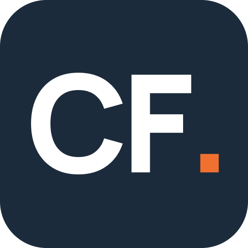

# Charles Talbot

Founder of [Closing Foundry](https://www.closingfoundry.com). I spent 20 years in enterprise sales and sales leadership (Yahoo, Lift, Marin Software, ChatLingual). Now I build the systems that help revenue teams sell better. See the client work at [closingfoundry.com/our-work](https://www.closingfoundry.com/our-work).

Most of my code is private, because it is product or client work. This page explains what is in it.

## Closing OS

[os.closingfoundry.com](https://os.closingfoundry.com), white-labelled as fac16. A multi-tenant revenue platform with role-based access and client, partner and investor portals. It holds 18 applications in four groups.

**Score**
- **Growth Score:** the published measurement standard. Scores capability and momentum, then gives a band, a problem lens and first actions.

**Design**
- **Sales Capability Rubric:** rubric scoring, team analytics and gap analysis for seller capabilities.
- **Capability Diagnostic:** scores seller and team capability on a 1–4 scale across five competency areas.
- **5 Days To Scale:** what to fix and how to execute, for rapid sales team transformation.
- **Value Thesis Navigator:** turns an investment thesis into an execution plan with recommended interventions.
- **Sales Readiness Score:** scored pillars, radar charts and a 30-day gap plan.
- **OS Configurator:** turns Closing OS standards into client-specific deployment packs for CRM and RevOps.
- **Value Creation Vault:** guidance and templates aligned to the investment hold lifecycle.

**Enable**
- **Playbooks & Training:** structured enablement content and training programmes.
- **Foundry Wiki:** the master IP engine (frameworks, schemas, skills and governance) that every client instance is built from.
- **Client Wiki:** each client's searchable engagement wiki of the thinking, tools and plans built for them.
- **Operator Wiki:** internal guides, templates and delivery standards.
- **Strategic Enablement:** aligning enablement with business strategy (in build).

**Run**
- **Deal Inspection:** inspect and qualify deals with structured frameworks and scoring.
- **Strawman:** value engineering, building business cases from discovery to customer success handoff.
- **Seller Income Planning Workbook:** turns income targets into daily activity by role.
- **Benchmark Leads:** internal pipeline for benchmark follow-ups and bookings.
- **Closing OS core:** the end-to-end closing operating system for complex B2B sales (in build).

## Next-best-action data layer and AE copilot

A data layer built from a sales playbook: a MEDDPICC question bank and 0–3 scoring rubric, stage behaviours with leading metrics, and stage playbooks from qualify to contract. It powers a full-cycle AE copilot: pre-discovery research, discovery and demo plans, business cases, proposals, negotiation plans and deal inspection from call transcripts.

## closingfoundry.com

Moved off Webflow to Cloudflare Pages, with byte-for-byte parity checks, a Markdown CMS builder and serverless forms.

## How I build

Claude Code and OpenAI Codex for building and review, GitHub for every change, Supabase and Cloudflare for hosting, Lovable for front-end speed.

## Contact

[LinkedIn](https://www.linkedin.com/in/charlestalbot) · charles@closingfoundry.com · happy to walk through any of this live.
